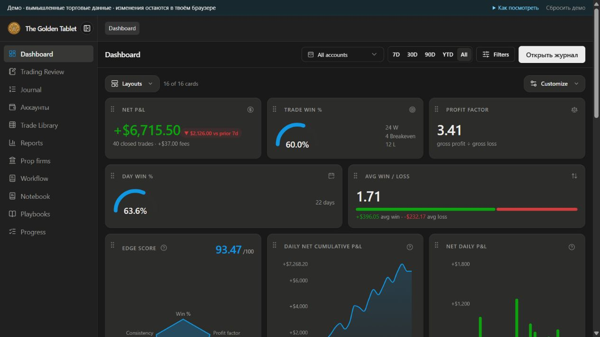

# The Golden Tablet

Торговый журнал, который связывает сделки, контекст решений и работу над качеством исполнения. Проект показывает полный цикл: **сделка → разбор дня → задача или правило → оценка процесса**.

Публичная версия — интерактивное демо для GitHub Pages. Его можно открыть по ссылке без установки: фильтровать сделки, менять записи, вести разбор и работать с задачами. Изменения сохраняются только в браузере посетителя. Кнопка «Сбросить демо» возвращает исходные примеры.



## Что посмотреть за несколько минут

1. **Dashboard** — результат серии, кривая PnL, распределение прибыльных и убыточных дней.
2. **Journal** — выберите аккаунт, откройте сделку, сравните фактический результат и упущенный потенциал.
3. **Trading Review** — откройте день октября 2026: подготовка, Live Session, итоги и связанные сделки.
4. **Workflow** — откройте категорию, создайте карточку, измените её статус. Slash-команды связывают заметки с задачами.
5. **Progress** — оцените подготовку, риск, вход и сопровождение отдельно от денежного результата.

В приложении также есть Accounts, Prop firms, Notebook, Playbooks и аналитические Reports.

## Данные и смысл показателей

В демо 40 вымышленных сделок за октябрь 2026 года: по десять на каждый из четырёх аккаунтов. Есть прибыльные и убыточные дни. FTMO, The5ers и FundedNext — реальные названия фирм, но показанные счета, условия, выплаты и результаты полностью вымышлены. Проект не связан с этими компаниями.

Фактический PnL и потенциальная прибыль учитываются раздельно. Потенциал не увеличивает баланс. В Dashboard Trade win % = Win / (Win + Loss + BE); в Journal Win Rate исключает BE, а Hit Rate учитывает BE. Это разные показатели. RR описывает результат относительно выбранной базы риска; сумма денег зависит ещё и от объёма аккаунта.

Подробнее: [сценарий демонстрации](docs/PORTFOLIO.md), [границы публичного демо](docs/PUBLIC-DEMO-AUDIT.md).

## Опубликовать на GitHub Pages

См. [PUBLISHING.md](PUBLISHING.md). Сборка и публикация настроены через GitHub Actions. Имя репозитория подставляется автоматически; API-ключи и отдельный сервер для публичного демо не нужны.

## Запуск разработчиком

Требуются Node.js 22+ и pnpm.

```sh
pnpm install --frozen-lockfile
pnpm demo:build
pnpm demo:preview
```

Локальный просмотр: http://127.0.0.1:3003

Полная локальная версия с SQLite:

```sh
pnpm demo:seed
pnpm local:build
pnpm local:start
```

Адрес полной версии: http://127.0.0.1:3002. Её база находится в `apps/web/data` и не входит в репозиторий.

## Устройство проекта

- `apps/demo` — статическая React/Vite-версия с локальным браузерным хранилищем и демоданными.
- `apps/web` — Next.js-приложение и общие экраны; серверная версия использует SQLite.
- `packages/core` — расчёты и аналитика без привязки к интерфейсу.
- `packages/importers` — обработка внешних торговых выгрузок в полной версии.
- `scripts` — сборка Pages, проверяемый экспорт демоданных и резервное копирование локальной версии.

`pnpm test` запускает проверки. Публичная сборка не включает серверные API и базу данных. Подключение брокеров, AI и загрузка файлов доступны только в полной локальной версии. Интерфейс пока сочетает русский язык с привычными английскими торговыми названиями.

## Происхождение кода

Это самостоятельная модифицированная портфолио-версия на основе открытого торгового журнала, а не заявление об авторстве всего исходного движка. Исходные условия MIT и уведомления об авторских правах сохранены в [LICENSE](LICENSE) и лицензиях пакетов.
